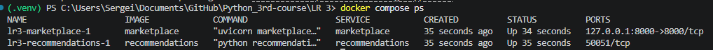
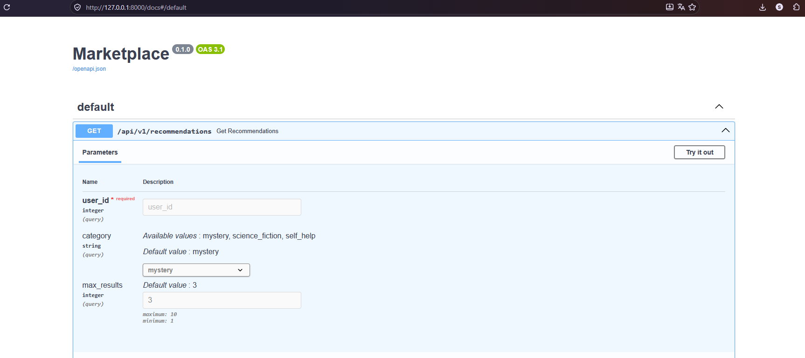
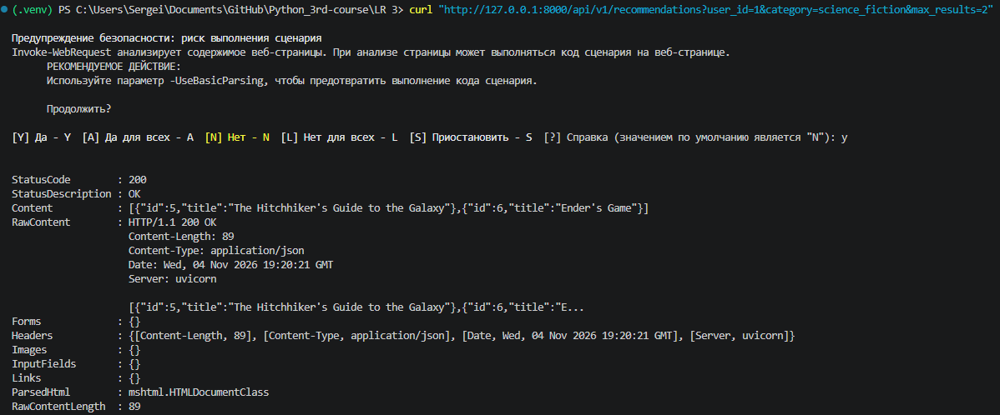
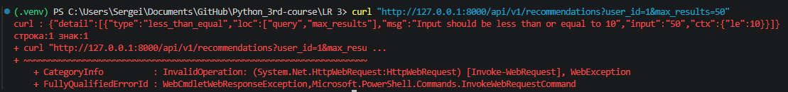

# Лабораторная работа 3. RPC. gRPC. Protobuf
## Постановка задачи
Изучите [пример](https://drive.google.com/file/d/1Jm3R78LdC6KRbwZVnBy9fzYP8_r6RchC/view) в колабе и выполните шаги, указанные там. Предоставьте ссылку на репозиторий GitHub со всеми необходимыми компонентами для развертывания. 

В репозитории отразите отчет с помощью файла с разметкой Markdown, где демонстрировался бы процесс развертывания и работы сервиса.

Замечание

Предполагается, что эта работа выполняется локально, не смотря на то, что написано в самом колабе. Поэтому адаптируйте с помощью LLM те команды по настройке среды, которые вы найдете в борде. Они изменятся минимально. 

## Структура проекта
```
├── README.md                  
├── compose.yaml               
├── .dockerignore                                 
├── protos/
│   └── recommendations.proto
├── marketplace/
│   ├── Dockerfile             
│   ├── marketplace.py         
│   ├── requirements.txt       
│   └── test_marketplace.py    
└── recommendations/
    ├── Dockerfile             
    ├── recommendations.py     
    └── requirements.txt       
```
## Демонстрация работы
Для запуска приложения в корневой директории проекта необходимо выполнить команду:
```
docker compose up --build -d
```
После этого Docker создаст изолированную сеть, соберет образы и поднимет контейнеры. Для проверки статуса контейнеров необходимо выполнить:
```
docker compose ps
```


FastAPI автоматически генерирует документацию. Она доступна по адресу: http://127.0.0.1:8000/docs



При переходе на страницу с указанием категории рендерится HTML-страница


Проверка работы конечной точки API через терминал с помощью curl:



Попытка передать неверный аргумент (превышение лимита max_results):




## Упражнения для самопроверки
### Упражнение 1. Добавление метода SayGoodbye в Greeter
Изменения в helloword.proto
```protobuf
service Greeter {
  rpc SayHello (HelloRequest) returns (HelloReply);
  rpc SayHelloAgain (HelloRequest) returns (HelloReply);
  rpc SayGoodbye (GoodbyeRequest) returns (GoodbyeReply);
}

message GoodbyeRequest {
  string name = 1;
}

message GoodbyeReply {
  string message = 1;
}
```
Реализация на сервере (greeter_server.py):
```python
class Greeter(helloworld_pb2_grpc.GreeterServicer):
    #  существующие методы 
    def SayGoodbye(self, request, context):
        return helloworld_pb2.GoodbyeReply(message=f"Goodbye, {request.name}!")
```
Вызов на клиенте (greeter_client.py):
```python
response = stub.SayGoodbye(helloworld_pb2.GoodbyeRequest(name="Heisenberg"), timeout=5)
print("Greeter client received:", response.message)
```
### Упражнение 2. Ручное вычисление varint для Demo(a=300)
a - 1 байт (08)
300 - 2 байта (AC 02)
Ответ: 3 байта. 08 AC 02
### Упражнение 3. Фильтрация прочитанных книг
Сделано в коде микросервиса Recommendations (recommendations.proto и recommendations.py)
### Упражнение 4. Клиентский поток AddBooks в LibraryService
Изменения в library_service.proto:
```protobuf
service LibraryService {
  //  существующие методы 
  rpc AddBooks (stream Book) returns (Report);
}
```
Реализация на сервере (library_server.py):
```python
def AddBooks(self, request_iterator, context):
    added_count = 0
    genres = []
    
    for book in request_iterator:
        self._books[book.id] = book
        added_count += 1
        genres.append(library_pb2.Genre.Name(book.genre))
        
    by_genre = Counter(genres)
    return library_service_pb2.Report(total_books=len(self._books), books_by_genre=by_genre)
```
### Упражнение 5. Параметр category на главной странице Marketplace
Сделано в коде микросервиса Marketplace (marketplace.py и test_marketplace.py)